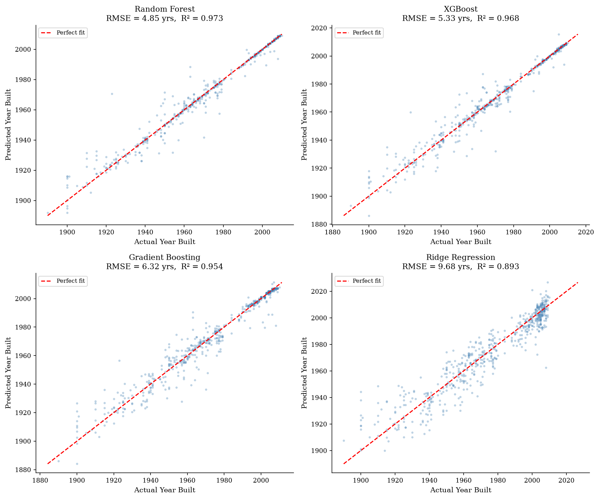
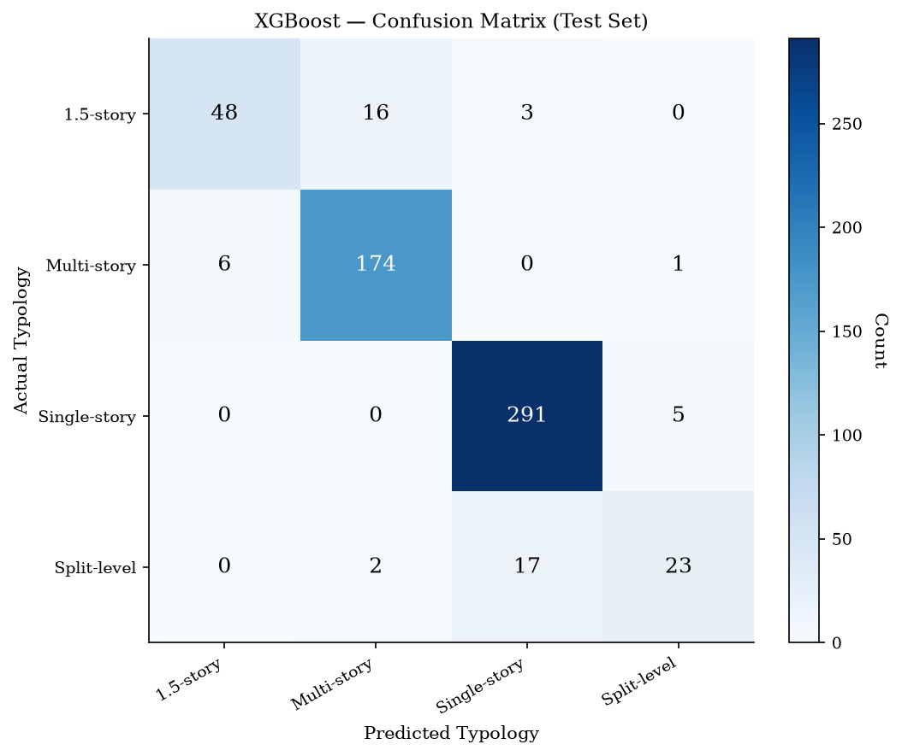

# Ames Housing: Predicting Construction Year and Architectural Style

Can you tell when a house was built, and what kind of house it is, from its physical layout alone? This project answers that with machine learning on the [Ames Housing Dataset](https://www.kaggle.com/datasets/prevek18/ames-housing-dataset) (De Cock, 2011), deliberately without using any price or sales data.

| Task | Target | Best model | Test-set result (n = 586) |
| --- | --- | --- | --- |
| Regression | Year the house was built | XGBoost, tuned | **RMSE 8.40 years, R² 0.920** |
| Classification | House style (4 classes) | XGBoost, tuned | **Accuracy 91.8%, macro F1 0.837** |

Group project for the *Statistical Learning* course, University of Duisburg-Essen (Summer Semester 2026), by **Rezaul Hoque** and **Sarah Al-Talal**.



## Research questions

1. **Construction year (regression).** How accurately can a model predict a home's original construction year from its materials, layout and quality ratings, with no dates and no market data as inputs?
2. **Architectural style (classification).** Can a model recover a home's style (one-story, 1.5-story, two-story or split-level) from its footprint and room layout alone, and which features separate the styles best?

## Approach

- **Data:** 2,930 houses and 82 variables. Administrative IDs and four columns with more than 70% missing values were dropped.
- **No leakage:** features that would give the answer away were removed before modelling, for example garage build year (a near-copy of the target) and `MS SubClass` (which encodes the house style).
- **Preprocessing:** a shared scikit-learn `ColumnTransformer`, fitted on the training data only, with Yeo-Johnson transforms for skewed variables and categorical encoding.
- **Split:** 80/20 train/test split with a fixed seed. The classification split is stratified to keep all four styles represented.
- **Models compared:** nine regressors and eight classifiers, from linear models through kernel and instance-based methods (SVR/SVC, k-NN) to tree ensembles (Random Forest, Gradient Boosting, XGBoost) and a neural network.
- **Validation:** five-fold cross-validation on the training set, using MSE for regression and macro F1 for classification, since the classes are imbalanced (one-story houses make up 50.5%).
- **Tuning:** randomized and grid search for Random Forest, Gradient Boosting, XGBoost and SVR/SVC.

## Key findings

- **Tree ensembles win both tasks.** Random Forest, Gradient Boosting and XGBoost consistently beat the linear, kernel and k-NN models, and cross-validation confirms this isn't a lucky split.
- **Tuning matters for XGBoost.** It moved from third place (RMSE 9.32) to the best model overall (RMSE 8.40) after the hyperparameter search.
- **Two features dominate.** Basement quality (about 40–55% importance) and second-floor area (about 31–33%) are the strongest predictors.
- **Accuracy vs. interpretability.** The linear models lose about 2.5 years of RMSE against tuned XGBoost but stay fully interpretable, a trade-off the report discusses.



## Repository structure

```
.
├── data/raw/AmesHousing.csv       # source dataset
├── notebooks/
│   ├── preprocessing.ipynb         # cleaning, leakage checks, feature pipeline
│   ├── regression.ipynb            # construction-year models
│   ├── classification.ipynb        # house-style models
│   └── housingprediction.ipynb     # exploratory work
├── scripts/generate_figures.py     # regenerates every figure used in the report
├── figures/                        # figures used in the report and this README
├── report/
│   ├── report.Rmd                  # report source (R Markdown, UDE template)
│   └── Statistical_Learning_Group7_Report.pdf
└── requirements.txt
```

## How to run

```bash
python -m venv .venv
# Windows: .venv\Scripts\activate   |   macOS/Linux: source .venv/bin/activate
pip install -r requirements.txt

# Run the notebooks in order: preprocessing, regression, classification.
# Then regenerate the figures used in the report:
python scripts/generate_figures.py
```

The report is written in R Markdown. To rebuild the PDF, knit `report/report.Rmd` in RStudio (needs R, `rmarkdown` and a LaTeX installation).

## Tech stack

Python (pandas, NumPy, scikit-learn, XGBoost, category-encoders, Matplotlib, seaborn), Jupyter and R Markdown with LaTeX for the report.

## Reference

De Cock, D. (2011). Ames, Iowa: Alternative to the Boston Housing Data as an End of Semester Regression Project. *Journal of Statistics Education*, 19(3).
