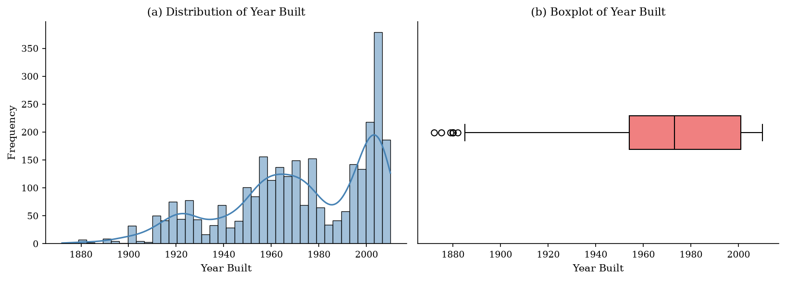
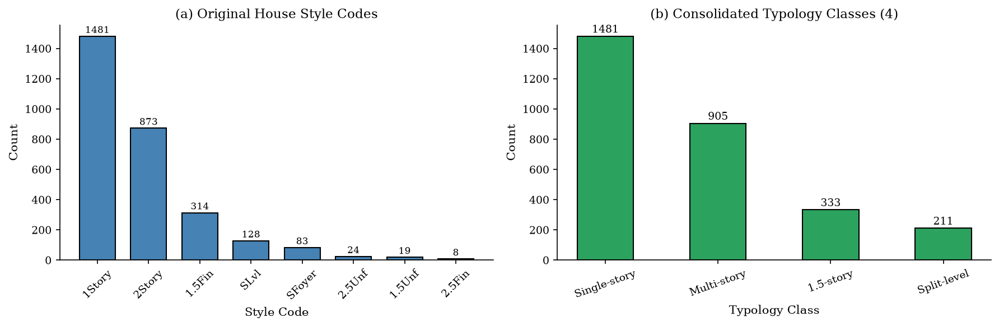
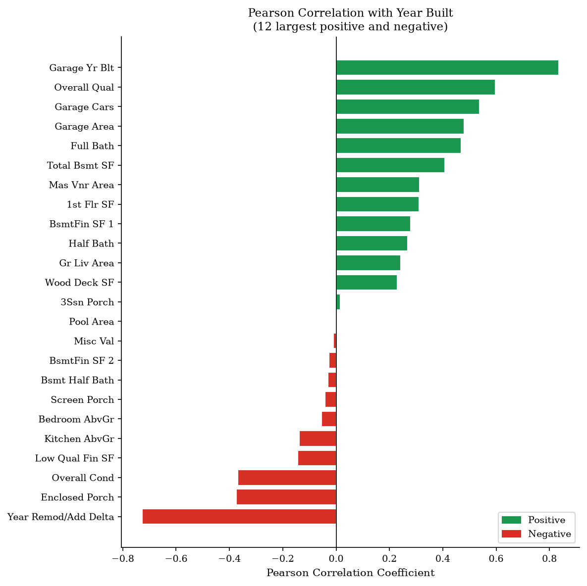
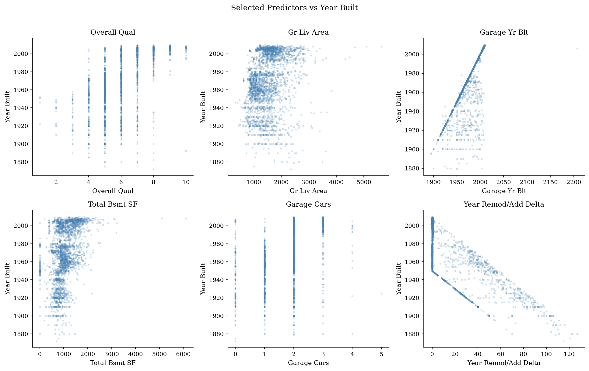
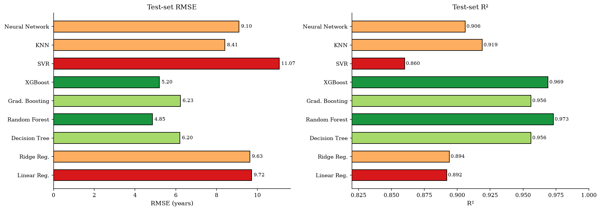
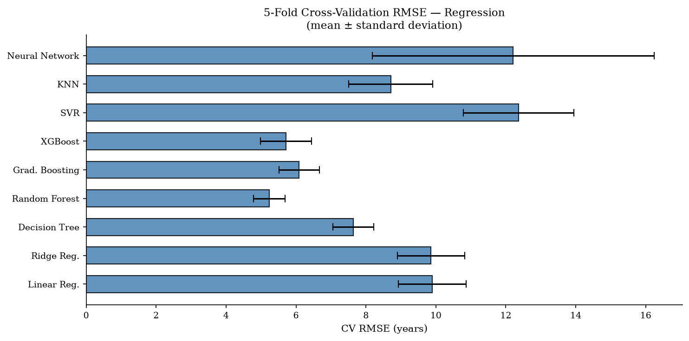
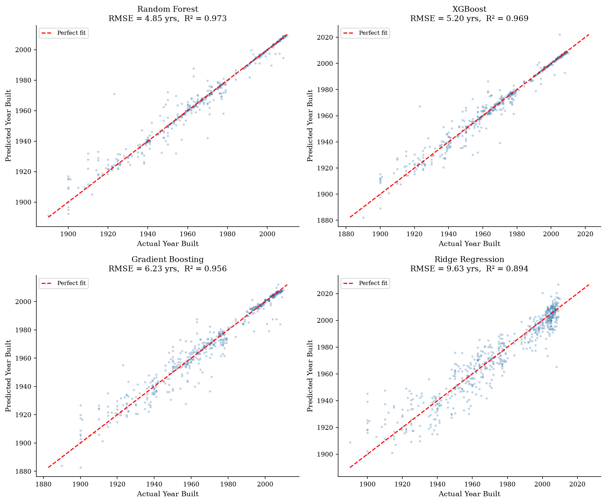
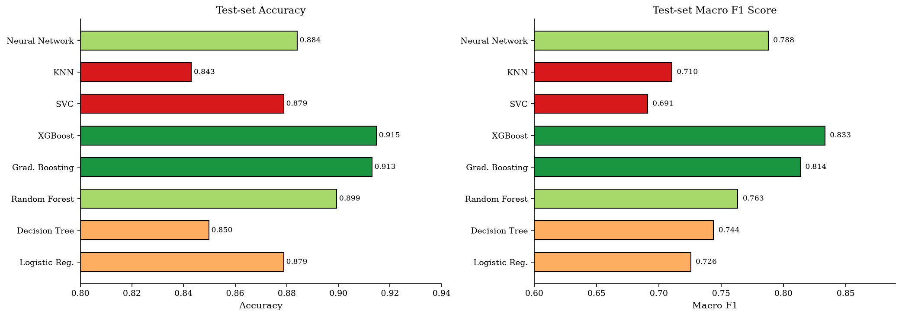
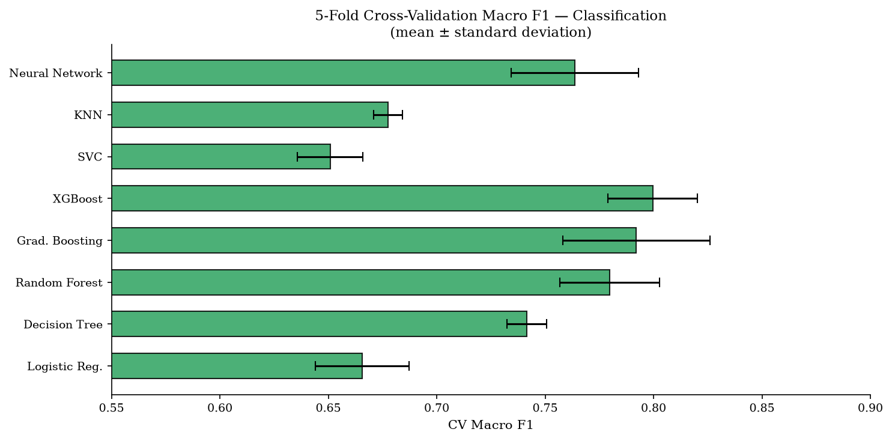
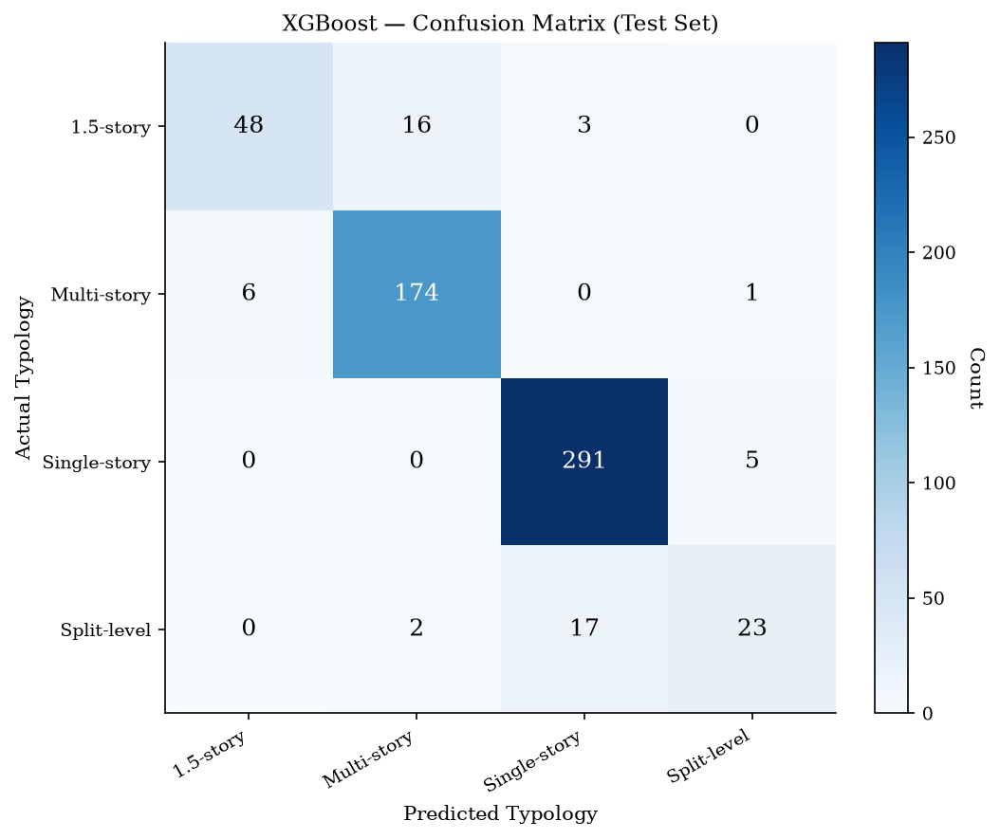

```{r setup, include=FALSE}
knitr::opts_chunk$set(echo = FALSE, message = FALSE, warning = FALSE,
                      fig.align = "center", fig.pos = "htbp")
```

# Introduction

The Ames Housing Dataset [@DeCock2011] documents 2,930 residential property sales in Ames, Iowa between 2006 and 2010 and contains 82 variables covering physical dimensions, material quality ratings, basement and garage attributes, and neighbourhood classification. While the dataset is most commonly applied to predicting sale price, this study redirects attention to the structural and architectural information embedded in the physical record of each property.

While much of the existing literature applies machine learning to residential property price prediction [@ChoyHo2023; @HoTangWong2020; @JinXu2025], previous studies have extensively applied the dataset to residential property price prediction while also identifying the housing characteristics that most strongly influence market value [@HoTangWong2020; @TeohEtAl2023].

Two prediction tasks motivate the analysis. The first is a regression problem: estimating the original year of construction from a property's physical attributes and quality ratings, without access to temporal metadata or market data. The hypothesis is that construction era leaves a measurable signature in material choices, room configurations, and the presence of amenities that changed systematically across the twentieth century. The second task is a four-class classification problem: predicting a property's architectural typology — whether it is single-story, multi-story, one-and-a-half story, or split-level — from its spatial and structural measurements. The goal here is to establish which geometric features most reliably distinguish residential forms.

By shifting the prediction targets while using the same rich set of structural, spatial and qualitative housing characteristics, this project demonstrates an alternative application of the Ames Housing dataset.

Both tasks are treated as independent prediction problems sharing a common preprocessing pipeline. Nine regression algorithms and eight classification algorithms are compared, selected to represent a range of learning strategies from interpretable linear models to opaque ensemble methods. A key concern throughout is not only predictive performance but also the degree to which each model class supports interpretation of its results.

# Exploratory Data Analysis

The Ames Housing dataset used in this project contains 2,930 residential property observations described by 82 variables, excluding the unique identifier. These variables capture a broad range of structural, spatial, and qualitative characteristics of residential properties sold in Ames, Iowa. The diversity of the available features provides a comprehensive representation of each property, making the dataset well suited for supervised machine learning applications.

The dataset consists of both numerical and categorical variables. Numerical variables describe measurable characteristics such as lot area, above-ground living area, garage capacity, construction year and basement size. Categorical variables capture qualitative information including neighborhood, building type, exterior materials, heating quality, roof style, and kitchen quality. The combination of numerical and categorical attributes enables machine learning models to learn complex relationships between different aspects of residential properties.

For this project, the dataset is used to address two supervised learning tasks. The regression task predicts a property construction year (`Year Built`), while the classification task predicts its architectural style (`House Style`). All remaining relevant variables serve as predictor variables after the preprocessing procedures described in Chapter 3.

Table 1 provides an overview of the dataset characteristics before preprocessing.

| Characteristics | Value |
|---|---|
| Dataset | Ames Housing Dataset |
| Source | Kaggle |
| Observations | 2,930 |
| Variables | 82 |
| Numerical Variables | 39 |
| Categorical Variables | 43 |
| Regression Target | Year Built |
| Classification Target | House Style |

Table: Dataset Characteristics. {#tbl-dataset-characteristics}

## Target Variable Distributions

**Year Built.** Construction years span from 1872 to 2010, with a mean of 1971.4 and a standard deviation of 30.2 years. The distribution is moderately left-skewed (skewness = $-0.604$, kurtosis = $-0.502$), reflecting the historical accumulation of housing stock — few nineteenth-century properties survive in the sample, while the bulk of observations are concentrated from the mid-twentieth century onward. Figure \ref{fig:yearbuilt} illustrates this distribution.

```{r fig-yearbuilt, fig.cap="\\label{fig:yearbuilt}Distribution of Year Built: histogram with kernel density estimate (left) and boxplot (right). The left-skewed shape reflects the uneven historical accumulation of housing stock in the dataset.", out.width="\\textwidth"}

```

**House Style.** The original dataset records eight architectural style codes. For modelling purposes, these are consolidated into four typology classes: Single-story (n = 1,481; 50.5\%), Multi-story (n = 905; 30.9\%), 1.5-story (n = 333; 11.4\%), and Split-level (n = 211; 7.2\%). The distribution is considerably imbalanced, with the Single-story class containing more than twice the observations of the next largest class. This imbalance has direct implications for the choice of classification evaluation metric, as discussed in Section \ref{model-selection}. Figure \ref{fig:housestyle} shows the class counts before and after consolidation.

```{r fig-housestyle, fig.cap="\\label{fig:housestyle}House Style distribution. Left: the original eight style codes. Right: the four typology classes used in modelling, formed by grouping related codes.", out.width="\\textwidth"}

```

## Predictor Relationships

Pearson correlations between numerical predictors and Year Built were computed to identify features carrying a temporal signal. Figure \ref{fig:correlation} displays the 12 largest positive and 12 largest negative correlates. Garage Year Built has the strongest positive association, reflecting the common practice of constructing the garage alongside the main dwelling. Overall Quality and Ground Living Area are also strongly positively correlated, consistent with the historical trend towards higher-grade materials and larger floor plans in more recent construction. Negative correlates include variables associated with older residential conventions, such as Enclosed Porch area and certain basement configurations.

```{r fig-correlation, fig.cap="\\label{fig:correlation}Pearson correlation between numerical predictors and Year Built. Green bars indicate positive correlations; red bars indicate negative correlations. The 12 strongest in each direction are shown.", out.width="0.85\\textwidth"}

```

Figure \ref{fig:scatter} confirms these relationships through scatter plots of the six most strongly correlated predictors. The near-linear association between Garage Year Built and Year Built is particularly pronounced. Overall Quality shows a step-pattern consistent with the periodic revision of building standards. The Year Remod/Add Delta feature — the number of years between construction and last remodel — is zero for properties that have never been renovated (the majority), which generates a distinctive clustering near zero.

```{r fig-scatter, fig.cap="\\label{fig:scatter}Scatter plots of six key numerical predictors against Year Built. Each point represents one property.", out.width="\\textwidth"}

```

# Data Preprocessing

## Missing Value Handling

Four columns were removed prior to analysis: `Alley`, `Pool QC`, `Fence`, and `Misc Feature`, each with more than 70\% missing values. Imputing columns at this level of missingness risks distorting the distribution beyond the informative range of the variable. Following this step, the dataset retained 78 variables. Any rows missing either target variable were subsequently removed, leaving 2,930 usable observations.

For the remaining missing values, imputation is handled inside the modelling pipeline rather than on the full dataset. Numerical features are imputed with the column median; categorical features are imputed with the mode. Keeping these steps inside the pipeline ensures that imputation statistics are estimated from the training fold only.

## Feature Engineering

A derived variable, `Year Remod/Add Delta`, is computed as the difference between the recorded remodel year and the construction year. This captures how recently a property was renovated relative to its build date without retaining the raw remodel year, which correlates directly with the regression target. The raw remodel year was then dropped.

Columns representing administrative identifiers (`Order`, `PID`) and sale circumstances (`SalePrice`, `Yr Sold`, `Mo Sold`) were excluded from both feature sets. `House Style` is copied to a separate series before being dropped from the shared feature frame so that it remains available as the classification target without functioning as a predictor for regression.

## Encoding and Scaling

Feature types were divided into five groups, each receiving an appropriate transformation. Sixteen numerical features with approximately symmetric distributions were assigned to a standardisation group: a Yeo-Johnson power transform was applied to reduce residual skew, followed by standardisation to zero mean and unit variance. Eight features with higher skewness were normalised instead, using the same power transform followed by min-max scaling. Twenty-one categorical features with a natural ordering (quality and condition ratings) were encoded with `OrdinalEncoder` using explicit category lists. Nominal features with fewer than ten distinct values received one-hot encoding, and high-cardinality features received binary encoding to limit dimensionality expansion.

## Leakage-Safe Pipeline

All transformation steps were assembled into a single `ColumnTransformer` composed of five sub-pipelines, one per feature group. The transformer was embedded in a scikit-learn `Pipeline` [@Pedregosa2011] alongside each estimator. This design ensures that imputers, scalers, and encoders are fitted exclusively on training data. Fitting any of these steps before the train/test split — a common but methodologically problematic shortcut — would introduce leakage: the imputer would borrow test-set values into training medians, and the scaler would align training bounds to the global distribution.

## Train/Test Split

The dataset was divided into a training set of 2,344 observations (80\%) and a held-out test set of 586 observations (20\%) using a fixed random seed for reproducibility. For the classification task, stratified sampling was applied to ensure proportional representation of all four typology classes in both folds, which is important given the small size of the Split-level class (n = 211).

The classification feature set differs from the regression set. Temporal predictors (`Year Built`, `Garage Yr Blt`, `Year Remod/Add Delta`) and `MS SubClass` — whose codes directly encode storey configuration — were excluded, leaving 30 geometric and structural features. Labels were encoded to integers prior to training for compatibility with the XGBoost implementation, with the original class names retained for display.

# Model Selection

## Regression Models

Nine algorithms were trained to represent a broad spectrum of learning strategies. Table \ref{tab:reg-models} summarises the model classes, their key methodological properties, and the primary justification for their inclusion.

```{r tab-reg-models, echo=FALSE}
reg_tbl <- data.frame(
  Model = c("Linear Regression", "Ridge Regression", "Decision Tree",
            "Random Forest", "Gradient Boosting", "XGBoost",
            "SVR", "KNN", "Neural Network"),
  `Key property` = c("Linear, no regularisation",
                     "Linear, L2 regularisation",
                     "Non-linear, single tree",
                     "Ensemble (bagging)",
                     "Ensemble (boosting)",
                     "Ensemble (boosting, regularised)",
                     "Kernel-based, non-linear",
                     "Instance-based",
                     "Feedforward network"),
  `Inclusion rationale` = c("Baseline; maximum interpretability",
                              "Regularised linear baseline; stable under collinearity",
                              "Non-linear, interpretable threshold model",
                              "Reduces tree variance; partial feature importance",
                              "Sequential residual fitting; strong on tabular data",
                              "As GB with additional regularisation and efficiency",
                              "Non-parametric; tests kernel bandwidth sensitivity",
                              "Non-parametric; local prediction behaviour",
                              "Flexible; tests deep-interaction capacity"),
  check.names = FALSE
)
knitr::kable(reg_tbl, caption = "\\label{tab:reg-models}Regression model classes and inclusion rationale.",
             booktabs = TRUE, linesep = "")
```

Polynomial Regression was initially considered but replaced by Ridge Regression. Applying a degree-2 polynomial expansion to the 150+ post-encoding features produces an approximately 11,000-column design matrix, causing ordinary least squares to diverge. Ridge Regression [@Hoerl1970] with $\alpha = 1.0$ provides the regularised linear baseline instead.

## Classification Models

Eight classifiers were trained using the same pipeline structure. The selection mirrors the regression panel: Logistic Regression as the linear baseline; Decision Tree as an interpretable non-linear baseline; Random Forest [@Breiman2001], Gradient Boosting [@Friedman2001], and XGBoost [@ChenGuestrin2016] as ensemble methods; Support Vector Classifier [@Cortes1995] as the kernel-based reference; K-Nearest Neighbours as the instance-based reference; and a Multi-Layer Perceptron as the neural network representative.

## Interpretability Considerations

Model interpretability was treated as an explicit criterion alongside predictive performance. The models in this study can be ranked roughly from most to least interpretable:

1. **Ridge / Linear Regression** — coefficients have a direct interpretation as the change in predicted construction year per unit increase in the corresponding standardised predictor.
2. **Decision Tree** — predictions are fully traceable through a tree structure; feature importance reflects the weighted impurity reduction across splits.
3. **Random Forest** — aggregated feature importance (mean decrease in impurity across all trees) is informative and reliable, though individual predictions are less traceable than for a single tree.
4. **Gradient Boosting / XGBoost** — feature importance via gain is analogous to Random Forest; SHAP values can be computed to explain individual predictions at the feature level.
5. **K-Nearest Neighbours** — any prediction can be traced to the $k$ nearest training observations, providing a form of case-based explanation.
6. **SVR** — the support vector representation and kernel function make direct attribution of predictions to input features difficult.
7. **Neural Network** — weights and activations are not directly interpretable at the predictor level.

Where two models produce similar predictive performance, the more interpretable variant is methodologically preferable. The regression results (Section \ref{results}) will show whether the accuracy gains of ensemble methods over linear baselines justify the reduction in interpretability.

## Evaluation Metrics

For regression, the primary metric is **Root Mean Squared Error (RMSE)** in years. RMSE penalises large individual errors and is expressed in the same units as the target, facilitating direct interpretation. Mean Absolute Error (MAE) and $R^2$ are reported as supplementary metrics.

For classification, **macro-averaged F1 score** is the primary metric. Given the substantial class imbalance (the Single-story class contains 50.5\% of observations), accuracy alone is insufficient: a model predicting the majority class for every observation would achieve roughly 50\% accuracy without learning any meaningful boundary. Macro F1 computes precision and recall per class and averages them with equal weight, penalising poor performance on minority classes as severely as poor performance on the majority. Accuracy, macro precision, and macro recall are reported alongside F1.

## Cross-Validation and Hyperparameter Tuning

Five-fold cross-validation was applied to all models to assess generalisation stability. For regression, negative mean squared error was the scoring criterion. For classification, accuracy was used.

Hyperparameter tuning was subsequently applied to the four best-performing models in each task. `RandomizedSearchCV` with 10 iterations was used for Random Forest and XGBoost, given their larger parameter spaces. `GridSearchCV` was used for Gradient Boosting and SVR/SVC. All searches were conducted with five-fold cross-validation on the training set, with the scoring criterion being negative MSE for regression and macro F1 for classification. The held-out test set was not accessed during tuning.

# Results

## Regression

Table \ref{tab:reg-results} reports test-set performance across all nine models. Random Forest achieves the lowest RMSE (4.85 years) and highest $R^2$ (0.973), with XGBoost close behind (RMSE = 5.20, $R^2$ = 0.969). All three ensemble methods substantially outperform the linear baselines, which plateau around $R^2 = 0.89$, confirming that non-linear interactions among predictors are necessary to recover the full chronological signal.

```{r tab-reg-results, echo=FALSE}
reg_res <- data.frame(
  Model = c("Linear Regression", "Ridge Regression", "Decision Tree",
            "Random Forest", "Gradient Boosting", "XGBoost",
            "SVR", "KNN", "Neural Network"),
  MAE   = c(7.10, 7.04, 2.28, 2.02, 3.58, 2.59, 6.81, 4.89, 6.39),
  RMSE  = c(9.72, 9.63, 6.20, 4.85, 6.23, 5.20, 11.07, 8.41, 9.10),
  R2    = c(0.892, 0.894, 0.956, 0.973, 0.956, 0.969, 0.860, 0.919, 0.906),
  check.names = FALSE
)
knitr::kable(reg_res,
             caption = "\\label{tab:reg-results}Regression results on the held-out test set (n = 586). MAE and RMSE are in years. Bold values indicate the best result per metric.",
             booktabs = TRUE, linesep = "", digits = 3,
             col.names = c("Model", "MAE (yrs)", "RMSE (yrs)", "R\\textsuperscript{2}"))
```

Figure \ref{fig:reg-comp} visualises these results. The colour coding — green for the two best models, orange for mid-range, red for the three worst — clarifies the performance gap between tree ensembles and other approaches.

```{r fig-reg-comp, fig.cap="\\label{fig:reg-comp}Comparison of all nine regression models by test-set RMSE (left) and R\\textsuperscript{2} (right). Colour indicates rank: green = top 2, light green = ranks 3--4, orange = ranks 5--7, red = bottom 2.", out.width="\\textwidth"}

```

Table \ref{tab:reg-cv} reports five-fold cross-validation results, which broadly confirm the test-set ranking. The low standard deviations for Random Forest ($\pm 0.45$) and Gradient Boosting ($\pm 0.58$) indicate stable generalisation. The Neural Network shows the highest CV variance of any model (RMSE = 12.21 $\pm$ 4.03), well above its single test-set result of 9.10. This instability suggests the MLP's performance depends on how the data are divided — likely an interaction between the default architecture and the uneven temporal distribution of observations across folds.

```{r tab-reg-cv, echo=FALSE}
cv_reg <- data.frame(
  Model = c("Linear Regression", "Ridge Regression", "Decision Tree",
            "Random Forest", "Gradient Boosting", "XGBoost",
            "SVR", "KNN", "Neural Network"),
  Mean  = c(9.90, 9.86, 7.64, 5.24, 6.09, 5.71, 12.37, 8.71, 12.21),
  SD    = c(0.97, 0.96, 0.59, 0.45, 0.58, 0.73, 1.58, 1.20, 4.03),
  check.names = FALSE
)
knitr::kable(cv_reg,
             caption = "\\label{tab:reg-cv}Five-fold cross-validation results for regression. CV RMSE is in years.",
             booktabs = TRUE, linesep = "", digits = 2,
             col.names = c("Model", "CV RMSE mean (yrs)", "CV RMSE std"))
```

Figure \ref{fig:reg-cv} displays the CV results with error bars, making the instability of the linear models and the neural network visually apparent.

```{r fig-reg-cv, fig.cap="\\label{fig:reg-cv}Five-fold cross-validation RMSE for all regression models (mean $\\pm$ standard deviation).", out.width="\\textwidth"}

```

Figure \ref{fig:pred-actual} plots predicted against actual construction year for the four best-performing models. The Random Forest and XGBoost scatter plots show tight clustering around the perfect-prediction diagonal, with no systematic over- or under-prediction across the year range. The Ridge Regression plot shows a broader dispersion, particularly for properties built before 1940, where the linear model's inability to capture rare historical patterns is most apparent.

```{r fig-pred-actual, fig.cap="\\label{fig:pred-actual}Predicted vs actual Year Built for the four best-performing regression models. The red dashed line marks perfect prediction. RMSE and R\\textsuperscript{2} are reported in each panel title.", out.width="\\textwidth"}

```

Hyperparameter tuning produces divergent effects across the four models searched. Table \ref{tab:reg-tuned} reports test-set performance after tuning. Random Forest shows no improvement over its default configuration (RMSE rises marginally from 4.85 to 4.87 years, within the noise of a single train/test split), whereas Gradient Boosting and the Support Vector Regressor both improve substantially (RMSE falling from 6.23 to 5.11 years, and from 11.07 to 8.56 years, respectively). XGBoost improves moderately (from 5.20 to 4.90 years). Random Forest and XGBoost retain the first and second positions held before tuning, but the ranking narrows: all three tree-based ensembles now fall within 0.26 years of RMSE, while the tuned SVR remains clearly behind despite its improvement. This pattern suggests Random Forest's default hyperparameters were already well matched to this feature set, whereas Gradient Boosting, XGBoost, and the SVR benefited from a targeted search.

```{r tab-reg-tuned, echo=FALSE}
reg_tuned <- data.frame(
  Model = c("Random Forest", "Gradient Boosting", "XGBoost", "SVR"),
  MAE   = c(2.03, 2.53, 2.50, 4.93),
  RMSE  = c(4.87, 5.11, 4.90, 8.56),
  R2    = c(0.973, 0.970, 0.973, 0.917),
  check.names = FALSE
)
knitr::kable(reg_tuned,
             caption = "\\label{tab:reg-tuned}Regression results on the held-out test set after hyperparameter tuning (n = 586). Only the four models selected for tuning are shown; compare against the corresponding default-hyperparameter rows in Table \\ref{tab:reg-results}.",
             booktabs = TRUE, linesep = "", digits = 3,
             col.names = c("Model", "MAE (yrs)", "RMSE (yrs)", "R\\textsuperscript{2}"))
```

## Classification

Table \ref{tab:clf-results} reports test-set performance across all eight classifiers. XGBoost achieves the highest accuracy (91.5\%) and macro F1 (0.833), followed closely by Gradient Boosting (91.3\%, F1 = 0.814). The gap between accuracy and macro F1 for most models reveals the effect of class imbalance: models that correctly classify the dominant Single-story class but struggle with Split-level properties will show high accuracy but moderate F1.

```{r tab-clf-results, echo=FALSE}
clf_res <- data.frame(
  Model = c("Logistic Regression", "Decision Tree", "Random Forest",
            "Gradient Boosting", "XGBoost", "SVC", "KNN", "Neural Network"),
  Acc  = c(0.879, 0.850, 0.899, 0.913, 0.915, 0.879, 0.843, 0.881),
  Prec = c(0.792, 0.736, 0.897, 0.897, 0.881, 0.914, 0.780, 0.804),
  Rec  = c(0.699, 0.754, 0.728, 0.779, 0.802, 0.670, 0.675, 0.767),
  F1   = c(0.726, 0.744, 0.763, 0.814, 0.833, 0.691, 0.710, 0.783),
  check.names = FALSE
)
knitr::kable(clf_res,
             caption = "\\label{tab:clf-results}Classification results on the held-out test set (n = 586). All metrics are macro-averaged across the four typology classes.",
             booktabs = TRUE, linesep = "", digits = 3,
             col.names = c("Model", "Accuracy", "Precision", "Recall", "F1 (macro)"))
```

```{r fig-clf-comp, fig.cap="\\label{fig:clf-comp}Comparison of all eight classification models by test-set accuracy (left) and macro F1 score (right).", out.width="\\textwidth"}

```

Table \ref{tab:clf-cv} shows five-fold cross-validation results. The ranking is consistent with the test set, and standard deviations are small for most models. Gradient Boosting is notably stable (std = 0.006), while KNN shows the highest variability (std = 0.024), reflecting sensitivity to local data density across folds.

```{r tab-clf-cv, echo=FALSE}
cv_clf <- data.frame(
  Model = c("Logistic Regression", "Decision Tree", "Random Forest",
            "Gradient Boosting", "XGBoost", "SVC", "KNN", "Neural Network"),
  Mean  = c(0.869, 0.852, 0.904, 0.905, 0.910, 0.874, 0.836, 0.876),
  SD    = c(0.015, 0.018, 0.011, 0.006, 0.010, 0.011, 0.024, 0.017),
  check.names = FALSE
)
knitr::kable(cv_clf,
             caption = "\\label{tab:clf-cv}Five-fold cross-validation accuracy for all classification models.",
             booktabs = TRUE, linesep = "", digits = 3,
             col.names = c("Model", "CV Accuracy mean", "CV Accuracy std"))
```

```{r fig-clf-cv, fig.cap="\\label{fig:clf-cv}Five-fold cross-validation accuracy for all classification models (mean $\\pm$ standard deviation).", out.width="\\textwidth"}

```

Table \ref{tab:clf-tuned} reports test-set performance after hyperparameter tuning for the four classifiers selected. XGBoost improves further to become the best-performing model overall (accuracy 91.8\%, macro F1 = 0.837, up from 0.833 untuned). The Support Vector Classifier shows the largest gain from tuning of any model in either task: macro F1 rises from 0.691 to 0.796, driven by a wider margin parameter ($C = 10$, against a default of $C = 1$) that allows the decision boundary to extend further into minority-class regions. Gradient Boosting's tuned macro F1 (0.811) is marginally below its untuned value (0.814), a difference within the noise expected from optimising on cross-validated F1 rather than the held-out test set directly.

```{r tab-clf-tuned, echo=FALSE}
clf_tuned <- data.frame(
  Model = c("Random Forest", "Gradient Boosting", "XGBoost", "SVC"),
  Acc  = c(0.899, 0.910, 0.918, 0.896),
  Prec = c(0.893, 0.884, 0.884, 0.846),
  Rec  = c(0.735, 0.777, 0.806, 0.765),
  F1   = c(0.770, 0.811, 0.837, 0.796),
  check.names = FALSE
)
knitr::kable(clf_tuned,
             caption = "\\label{tab:clf-tuned}Classification results on the held-out test set after hyperparameter tuning (n = 586). Only the four models selected for tuning are shown; compare against the corresponding default-hyperparameter rows in Table \\ref{tab:clf-results}.",
             booktabs = TRUE, linesep = "", digits = 3,
             col.names = c("Model", "Accuracy", "Precision", "Recall", "F1 (macro)"))
```

Figure \ref{fig:confusion} shows the confusion matrix for the default (pre-tuning) XGBoost classifier, which was the best-performing model at that stage. The matrix reveals that Single-story and Multi-story properties are classified with high accuracy, while 1.5-story properties are occasionally misclassified as Multi-story and Split-level properties show the highest error rate, primarily being predicted as Single-story or Multi-story.

```{r fig-confusion, fig.cap="\\label{fig:confusion}Confusion matrix for the default (pre-tuning) XGBoost classifier on the held-out test set. Rows represent actual typology classes; columns represent predicted classes.", out.width="0.7\\textwidth"}

```

# Discussion and Conclusion

## Regression Task

The strong performance of tree-based ensemble methods (Random Forest $R^2 = 0.973$, XGBoost $R^2 = 0.969$) confirms that a property's physical attributes carry a chronological signal that machine learning can recover with high accuracy. The clear advantage of non-linear methods over linear baselines ($R^2 \approx 0.89$) is methodologically informative: approximately 11\% of variance in construction year is inaccessible to any linear combination of predictors, suggesting that the relationship between physical attributes and construction era involves threshold effects. This is consistent with the historical structure of building practice — materials and design standards did not shift continuously but were subject to periodic regulatory and technological step-changes, which decision boundaries in a tree can represent directly.

The default SVR underperforms the other non-linear methods (RMSE = 11.07, $R^2 = 0.860$), indicating that its default radial basis function kernel is poorly matched to this dataset's structure. Hyperparameter tuning substantially narrows this gap (RMSE falls to 8.56, Table \ref{tab:reg-tuned}), confirming that the shortfall was primarily a hyperparameter mismatch rather than a fundamental unsuitability of margin-based methods for this task. Even tuned, however, the SVR remains well behind the ensemble methods, indicating a persistent structural disadvantage on this high-dimensional, mixed-type feature set.

The neural network's cross-validation variance (RMSE = 12.21 $\pm$ 4.03) is markedly higher than its single test-set result (RMSE = 9.10), and higher than any tree-based model's CV variance. This divergence suggests that the MLP's performance is fold-dependent rather than robustly generalised. With 2,344 training observations and 150 post-encoding features, the default architecture likely lacks the capacity to exploit deep interaction effects consistently, while the uneven temporal distribution of observations across folds creates varying learning conditions.

## Classification Task

The classification results establish that architectural typology is recoverable from geometric measurements with reasonable accuracy. XGBoost is the strongest classifier both before tuning (91.5\% accuracy, macro F1 = 0.833) and after (91.8\% accuracy, macro F1 = 0.837), making it the best-performing model in either task after accounting for tuning. The gap between accuracy and macro F1 highlights the effect of class imbalance: the untuned SVC achieves 87.9\% accuracy but a macro F1 of only 0.691, driven by low recall (0.670) for the minority classes. Its high precision (0.914) indicates conservative decision boundaries — the model rarely ventures into minority-class territory, reserving those predictions for high-confidence cases. Tuning corrects most of this imbalance (macro F1 rises to 0.796, Table \ref{tab:clf-tuned}), which confirms the untuned SVC's weakness was a hyperparameter mismatch rather than an inherent limitation of margin-based classifiers on this feature set. This behaviour is systematically visible in the confusion matrix (Figure \ref{fig:confusion}): Split-level properties, which constitute only 7.2\% of the dataset, are misclassified at a higher rate than any other class.

The confusion between 1.5-story and Multi-story properties, and between Split-level and Single-story properties, is architecturally interpretable. Both 1.5-story and split-level forms occupy an intermediate position in the floor-area space: a one-and-a-half story home has a partial upper storey, and a split-level home has partial floors at offset heights. The 30-feature geometric representation captures aggregate measurements — total area, room counts, basement footprint — but not the volumetric arrangement that distinguishes these forms from a full two-story layout. This places a ceiling on classification accuracy that is independent of model choice.

## Model Interpretability

For the regression task, the two best models (Random Forest and XGBoost) offer partial interpretability via feature importance. Both methods identify Garage Year Built, Overall Quality, and Ground Living Area as the most informative predictors — a result that aligns with the correlation analysis in Section \ref{exploratory-data-analysis}. For applications where understanding which features drive a prediction is important, XGBoost with SHAP values would provide the most operationally useful explanations at the instance level.

The linear models (Linear Regression and Ridge) offer full coefficient-level interpretability but at a substantial accuracy cost: approximately 5 RMSE years relative to Random Forest. In settings where interpretability is the primary constraint and approximate accuracy is acceptable, Ridge Regression would be preferable. For most applications of this type, the performance gap justifies the trade-off in favour of Random Forest or XGBoost.

For classification, the Gradient Boosting and XGBoost classifiers offer analogous interpretability properties to their regression counterparts. The Decision Tree, though lower-performing, provides the most transparent model: a single tree can be visualised and every prediction traced to an explicit sequence of attribute thresholds. The similarity between Decision Tree accuracy (85.0\%) and Logistic Regression accuracy (87.9\%) suggests that non-linear boundaries alone do not account for the performance advantage of ensemble methods; variance reduction through aggregation is equally important.

## Limitations

Both tasks are evaluated on data from a single city over a four-year period. The chronological signal exploited by the regression model reflects construction norms specific to Ames, Iowa, and may not transfer to other geographic or cultural contexts. The four-class typology consolidation is one of several valid grouping choices; different groupings would produce different class boundaries and potentially different difficulty rankings for the classifiers.

Some geometric features retained in the classification feature set — such as garage size and basement finish level — are themselves correlated with construction era, which means the model may exploit an indirect temporal signal rather than purely spatial information. Disentangling these contributions would require a more controlled feature selection procedure or a residualisation approach.

## Conclusion

This study demonstrates that residential properties in the Ames Housing Dataset carry two forms of latent architectural information — construction era and structural typology — that machine learning can recover with high accuracy. Random Forest achieves the strongest regression performance (RMSE = 4.85 years, $R^2 = 0.973$) using its default hyperparameters, and tuned XGBoost achieves the strongest classification performance (accuracy = 91.8\%, macro F1 = 0.837). In both tasks, tree-based ensemble methods — bagged (Random Forest) or boosted (Gradient Boosting, XGBoost) — consistently outperform linear, kernel-based, and instance-based alternatives. Cross-validation confirms that these results are stable and not artefacts of a favourable train/test split.

From a methodological standpoint, the study illustrates three recurring considerations in tabular machine learning: the value of leakage-safe preprocessing pipelines, the importance of selecting evaluation metrics that account for class imbalance, and the trade-off between predictive accuracy and model interpretability. When the accuracy margin justifies it, ensemble methods provide an effective combination of strong generalisation and partial explainability through feature importance — a balance that makes them well suited to structured prediction tasks on housing data.


